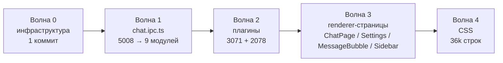

# Аудит размера кодовой базы — SynteeAgentDesktop

**Дата:** 26.10.2026 · **Версия:** 1.1.2 · **Замер:** `scripts/code-stats.ps1`

Документ нужен для одного: **понимать, что и в каком порядке разгружать**.
Все цифры — свои исходники, без `node_modules`, `Sidecar/target`, `dist`, `out`, `.git`.

---

## TL;DR

| Метрика | Значение |
|---|---:|
| Файлов исходников | **1 077** |
| Строк кода (ts/tsx/js/css/rs/py/cjs/mjs) | **203 746** |
| Средний файл | 189 строк (медиана 86 — нормально) |
| Файлов > 600 строк | **69** |
| Файлов > 1 000 строк | **33** |
| Файлов > 2 000 строк | **8** |
| CSS | 36 558 строк в 122 файлах (**18% кода**) |
| Git: коммитов / трекнутых файлов | 464 / 1 014 |
| Рабочая папка | **4 739 МБ / 65 062 файла** (кода там 61 МБ = 1,3%) |

**Вывод в одну строку:** объём — уровень коммерческого Electron-продукта, но **8 файлов-монстров держат ~20% сложности** и именно они тормозят разработку. Разгружать надо не «всё», а 69 файлов из списка ниже, начиная с `chat.ipc.ts`.

---

## 1. Объём по зонам

| Зона | Файлов | LOC | Доля |
|---|---:|---:|---:|
| `src/renderer` (React UI) | 595 | 109 788 | 53,9% |
| `src/core` (агент, тулы, БД, Fast Context, память) | 208 | 40 487 | 19,9% |
| `src/main` (Electron main + IPC + менеджеры) | 78 | 24 938 | 12,2% |
| `src/shared` | 80 | 7 821 | 3,8% |
| `scripts` (тесты, утилиты, .mjs/.cjs) | 47 | 5 741 | 2,8% |
| `Sidecar` (Rust: токены, AST, поиск, индексация) | 22 | 5 339 | 2,6% |
| `resources` (скилы, плагины, python-sdk) | 23 | 3 016 | 1,5% |
| `src/preload` | 2 | 2 547 | 1,2% |
| `backend` (Python, admin API) | 4 | 2 066 | 1,0% |
| `tests` | 12 | 1 043 | 0,5% |
| `frontend-admin` | 4 | 713 | 0,3% |
| конфиги (`electron.vite.config.ts`, `eslint.config.mjs`) | 2 | 247 | 0,1% |

**Что это значит:** больше половины кода — интерфейс. Ядро (агент + тулы + память + IPC) — примерно треть. Rust-sidecar — маленький, но плотный (средний файл 240 строк, всё по делу).

## 2. Объём по типам файлов

| Расширение | Файлов | Строк | Комментарий |
|---|---:|---:|---|
| `.ts` | 685 | 94 740 | основная логика |
| `.tsx` | 167 | 56 418 | React-компоненты |
| `.css` | 122 | 36 558 | **ручной CSS, без Tailwind** |
| `.json` | 256 | 17 937 | конфиги, локали, схемы тулов |
| `.md` | 58 | 9 703 | документация, скилы, планы |
| `.rs` | 21 | 5 221 | Rust sidecar |
| `.cjs` | 38 | 4 275 | тесты/скрипты |
| `.js` | 21 | 2 436 | — |
| `.py` | 5 | 2 361 | backend |
| `.mjs` | 18 | 1 774 | тесты/скрипты |

Соотношение **TS/TSX : CSS ≈ 4,1 : 1** — очень много стилей на единицу логики. Это следствие ручного CSS на каждый компонент (см. §5).

> В сумму 203 746 строк входят только код и стили. Сверх этого: **17 937 строк JSON** (конфиги, локали, схемы тулов) и **9 703 строки MD** (документация, скилы, планы) — они в оценке «размер кода» не участвуют, но в репозитории лежат.

## 3. Распределение файлов по размеру

| Диапазон | Файлов | Доля файлов | Оценка |
|---|---:|---:|---|
| > 2 000 строк | 8 | 0,7% | 🔴 разгружать обязательно |
| 1 000–2 000 | 25 | 2,3% | 🟠 разгружать по возможности |
| 600–1 000 | 36 | 3,3% | 🟡 кандидаты |
| 300–600 | 97 | 9,0% | 🟢 нормально |
| < 300 | 911 | 84,6% | ✅ здоровые модули |

Pareto работает жёстко: **топ-15 файлов = ~17% всего кода**. Остальные 1 000 файлов в среднем по 90 строк — это не проблема.

---

## 4. Hot spots — полный список файлов > 600 строк

### 🔴 Тир 1: > 2 000 строк (8 файлов, 23 063 строки = 11% кода)

| Строк | Файл | Что делать |
|---:|---|---|
| **5 008** | `src/main/ipc/chat.ipc.ts` | распилить на 9 модулей (см. §8, волна 1) |
| **3 071** | `src/core/plugins/pluginManager.ts` | вынести registry / installer / sandbox-api / manifest-валидацию |
| **3 012** | `src/renderer/src/pages/Chat/ChatPage.tsx` | вынести хуки: useChatSend, useChatRuns, useChatScroll, useChatAttachments |
| **2 829** | `src/renderer/src/pages/Settings/SettingsPage.tsx` | уже есть табы — вынести каждый таб в свою папку |
| **2 705** | `src/renderer/src/components/ui/MessageBubble/MessageBubble.tsx` | вынести рендер iterations / actions / attachments / editor |
| **2 289** | `src/renderer/src/components/layout/Sidebar/Sidebar.tsx` | вынести ChatList / ProjectList / Footer / ContextMenu |
| **2 078** | `src/core/plugins/pluginHost.ts` | разделить host (загрузка) и runtime (вызовы тулов) |
| **2 071** | `.../ExtensionsPopover/ExtensionsPopover.tsx` | по табам: MCP / Skills / Plugins (PluginsTab уже 740) |

### 🟠 Тир 2: 1 000–2 000 строк (25 файлов)

| Строк | Файл |
|---:|---|
| 1 853 | `src/core/agent/Agent.ts` |
| 1 826 | `renderer/.../Settings/SettingsPage.css` |
| 1 687 | `renderer/src/App.tsx` |
| 1 682 | `renderer/.../ExtensionsPopover/ExtensionsPopover.css` |
| 1 509 | `renderer/.../GitPanel/GitPanel.tsx` |
| 1 464 | `renderer/.../ToolChain/ToolChain.tsx` |
| 1 439 | `renderer/.../Dots/DotsPage.css` |
| 1 395 | `src/core/ai/AIClient.ts` |
| 1 383 | `renderer/.../MessageBubble/MessageBubble.css` |
| 1 296 | `src/preload/index.d.ts` (типы — ок, но стоит разбить по namespace) |
| 1 280 | `src/main/managers/BrowserManager.ts` |
| 1 265 | `renderer/.../AnimatedBackground/bg.worker.ts` |
| 1 251 | `src/preload/index.ts` |
| 1 240 | `src/main/managers/AgentManager.ts` |
| 1 158 | `renderer/.../ToolChain/ToolChain.css` |
| 1 136 | `renderer/.../ChatInput/ChatInput.css` |
| 1 104 | `renderer/src/styles/globals.css` |
| 1 074 | `renderer/.../ChatInput/ChatInput.tsx` |
| 1 066 | `src/main/workers/ai-worker.ts` |
| 1 064 | `src/core/marketplace/curatedMcp.ts` |
| 1 047 | `renderer/.../AISettingsTab/AISettingsTab.css` |
| 1 043 | `renderer/.../StatisticsSection/StatisticsSection.tsx` |
| 1 035 | `renderer/.../CustomThemeEditor/CustomThemeEditor.tsx` |
| 1 024 | `renderer/.../GitPanel/GitPanel.css` |
| 1 014 | `src/core/tools/scrape.ts` |

### 🟡 Тир 3: 600–1 000 строк (36 файлов)

| Строк | Файл |
|---:|---|
| 995 | `renderer/.../Memory/MemoryPage.tsx` |
| 961 | `renderer/.../Sidebar/Sidebar.css` |
| 942 | `renderer/.../SessionChangesPanel/SessionChangesPanel.tsx` |
| 926 | `backend/app/services/routing/anthropic_sdk_adapter.py` |
| 917 | `renderer/.../SplitChatPane/SplitChatPane.tsx` |
| 914 | `Sidecar/src/db.rs` |
| 856 | `renderer/.../Memory/MemoryGraphTab.css` |
| 847 | `src/core/agent/toolDispatcher.ts` |
| 843 | `src/main/managers/DotManager.ts` |
| 836 | `renderer/.../SessionChangesPanel/SessionChangesPanel.css` |
| 827 | `renderer/.../ProfileSection/ProfileSection.tsx` |
| 820 | `src/core/agent/commandSafety.ts` |
| 813 | `renderer/.../Chat/ChatPage.css` |
| 801 | `src/core/memory/store/search.ts` |
| 797 | `renderer/.../StatisticsSection/StatisticsSection.css` |
| 791 | `renderer/.../Messenger/MessengerConversation.tsx` |
| 782 | `renderer/.../Memory/MemoryPage.css` |
| 745 | `src/main/managers/PtyManager.ts` |
| 742 | `renderer/.../ModelSelector/ModelSelector.tsx` |
| 740 | `renderer/.../ExtensionsPopover/PluginsTab.tsx` |
| 698 | `renderer/.../CustomThemeEditor/CustomThemeEditor.css` |
| 678 | `src/core/memory/semanticIndex.ts` |
| 670 | `renderer/.../RightPanel/RightPanel.tsx` |
| 670 | `src/core/agent/utils.ts` |
| 657 | `renderer/src/store/chat.store.ts` |
| 642 | `renderer/.../ChatInput/ChatInputEditor.tsx` |
| 639 | `renderer/.../ProjectSettingsModal/ProjectSettingsModal.css` |
| 639 | `renderer/.../Memory/MemoryGraphTab.tsx` |
| 630 | `src/main/tools/spaRenderer.ts` |
| 627 | `src/core/memory/graphExtractor.ts` |
| 625 | `Sidecar/src/search.rs` |
| 622 | `renderer/.../Spotlight/SpotlightPage.tsx` |
| 613 | `renderer/src/store/messenger.store.ts` |
| 611 | `renderer/.../AISettingsTab/AISettingsTab.tsx` |
| 610 | `src/main/ipc/index.ts` |
| 608 | `backend/app/api/admin/health.py` |

---

## 5. CSS — отдельная история

36 558 строк в 122 файлах. Почти каждый компонент тянет свой `.css` на 800–1 800 строк, и стили растут быстрее логики.

| Строк | Файл |
|---:|---|
| 1 826 | `pages/Settings/SettingsPage.css` |
| 1 682 | `ui/ExtensionsPopover/ExtensionsPopover.css` |
| 1 439 | `pages/Dots/DotsPage.css` |
| 1 383 | `ui/MessageBubble/MessageBubble.css` |
| 1 158 | `ui/ToolChain/ToolChain.css` |
| 1 136 | `ui/ChatInput/ChatInput.css` |
| 1 104 | `styles/globals.css` |
| 1 047 | `settings/AISettingsTab/AISettingsTab.css` |
| 1 024 | `ui/GitPanel/GitPanel.css` |
| 961 | `layout/Sidebar/Sidebar.css` |

Причины роста: один файл на компонент + варианты состояний (`--running`, `--collapsed`, темы, media-queries) в одном месте.

**Дешёвая разгрузка без миграции на Tailwind:** разбить каждый большой `.css` по BEM-блоку (`ChatInput.css` → `ChatInput.attachments.css`, `ChatInput.editor.css`, `ChatInput.actions.css`) и вынести переменные темы в один `tokens.css`. Риск нулевой, эффект — навигация и размер диффов.

---

## 6. Вес на диске и история

### 6.1. Диск: 4 739 МБ / 65 062 файла

| Что | МБ | Доля |
|---|---:|---:|
| `Sidecar/target` (артефакты Rust-сборки) | 2 351 | 49,6% |
| `node_modules` | 2 246 | 47,4% |
| исходники + конфиги + docs | 61 | 1,3% |
| прочее (`.git` 12 МБ и мелочь) | 81 | 1,7% |

Топ пакетов: `@huggingface` 475 МБ, `electron` 368, `onnxruntime-node` 287, `app-builder-bin` 207, `node-pty` 151, `onnxruntime-web` 139, `monaco-editor` 100, `mermaid` 84.

> `Sidecar/target` можно смело чистить (`cargo clean`) — это 2,3 ГБ кэша сборки. В git не попадает.

### 6.2. Git

| Метрика | Значение |
|---|---:|
| Коммитов | 464 |
| Авторы | cegor 438, alex8088 27 (шаблон), Luneex 10, прочие 2 |
| Первый коммит (реальный старт) | июнь 2026 |
| Добавлено / удалено за всю историю | +345 305 / −90 502 |
| Средний коммит | ~744 добавленных строк |
| Веток / тегов | 8 / 14 |
| `.git` | 12,4 МБ |

Коммиты по месяцам: **июнь 252**, июль 31, август 66, сентябрь 57, октябрь 29.
Июнь — это буст старта (шаблон + каркас), дальше устойчивый темп 30–65 коммитов/мес и **~45 000 LOC в месяц** — типичный профиль AI-assisted разработки.

---

## 7. С чем сравнить

| Ориентир | LOC | Syntee относительно |
|---|---:|---|
| Electron-приложение соло-разработчика | 30–80k | в 2,5–7 раз больше |
| Коммерческий Electron-клиент (Slack/Notion-класс) | 150–300k | **в той же лиге** |
| Ядро SQLite | ~150k | немного крупнее |
| VS Code | ~1,6M | в 8 раз меньше |
| Chromium | ~30M | в 150 раз меньше |

---

## 8. План разгрузки по волнам

Правило: **одна волна = одна тема**, каждая волна заканчивается зелёными `get_diagnostics` + `npm run build` + ручным смоук-тестом. Цель — ни один файл не больше 800 строк, кроме осознанных исключений (`preload/index.d.ts`, `curatedMcp.ts` — это данные).



### Волна 0 — инфраструктура (полдня)

1. `scripts/code-stats.ps1` — замер LOC по зонам (уже создан, запускается руками).
2. Правило в `eslint.config.mjs`: `max-lines: ['warn', 800]` — новые файлы не растут, старые в списке исключений.
3. Чеклист «что можно резать без риска»: CSS по блокам → чистые функции → хуки → компоненты.

### Волна 1 — `src/main/ipc/chat.ipc.ts` (5 008 строк) 🔥

Сейчас это **57 `ipcMain.handle` внутри одной функции `registerChatIPC()` (строки 679–5187)**, каналы: `chat:*` 45, `context:*` 6, `task-summary:*` 4, `goal:*` 2.

Предлагаемая нарезка (каждый модуль экспортирует `register*(deps)`):

```
src/main/ipc/chat/
  index.ts              # registerChatIPC — только сборка
  shared/runRegistry.ts # activeRuns, queue, flushRunIter, buildLiveIters, buildFinalIters
  send.ts               # chat:send, chat:steer, chat:queue, drainQueue
  history.ts            # chat:list/messages/delete/rename/pin, deleteMiddleMessagesFromDB
  compact.ts            # /compact, createCompactDivider, emitChatCompacted
  recall.ts             # auto-recall: searchAutoRecallCached, extractRecallKeywords, dedup
  summary.ts            # task-summary:*, goal:*
  context.ts            # context:* (contextManager мост)
  autotitle.ts          # autoNameChat, cleanAutoTitle, localAutoTitle
  utils.ts              # repairMarkdownFence, ensureToolResults, fmtTokensK, pathHash
```

Порядок безопасный: сначала `utils.ts` и `shared/runRegistry.ts` (чистое перемещение), потом группы каналов. Проверка после каждого шага — смоук: отправить сообщение, получить стрим, остановить, переключить чат, компакт.

### Волна 2 — плагины (5 149 строк на два файла)

- `pluginManager.ts` (3 071): registry / install-uninstall / permissions / manifest-validation / marketplace-sync.
- `pluginHost.ts` (2 078): загрузка (require, sandbox) отдельно от вызова тулов и lifecycle (`activate`/`deactivate`).
- Тесты: `scripts/plugin*.test.mjs` уже есть — гонять после каждого шага.

### Волна 3 — renderer (≈11 900 строк в 5 файлах)

| Файл | На что резать |
|---|---|
| `ChatPage.tsx` 3 012 | `useChatSend`, `useChatRuns` (live state + queue), `useChatScroll`, `useChatAttachments`, `useChatContextMenu` |
| `SettingsPage.tsx` 2 829 | табы → папки `tabs/GeneralTab`, `tabs/ModelsTab`, ... (многое уже вынесено в `components/settings/*`) |
| `MessageBubble.tsx` 2 705 | `IterationsList`, `MessageActions`, `AttachmentList`, `InlineEditor` |
| `Sidebar.tsx` 2 289 | `ChatList`, `ProjectSection`, `SidebarFooter`, `ChatContextMenu` |
| `ExtensionsPopover.tsx` 2 071 | табы MCP / Skills / Plugins |

Осторожно: это самые «горячие» файлы (steering, live-рендер, ToolChain-секции). Резать **только перемещением**, без изменения логики, по одному компоненту за коммит.

### Волна 4 — CSS (36 558 строк)

1. `styles/tokens.css` — все CSS-переменные темы из `globals.css` в одно место.
2. Каждый `.css` > 800 строк — разбить по BEM-блокам, импорты в `index.css` компонента.
3. Проверить дубли: одинаковые `.btn`, `.chip`, `.modal`-паттерны копируются между компонентами — собрать в `styles/primitives.css`.

### Чего НЕ трогать

- `src/preload/index.d.ts` (1 296) и `curatedMcp.ts` (1 064) — типы и данные, дробление вредит.
- `bg.worker.ts` (1 265) — изолированный воркер, живёт своей жизнью.
- `Sidecar/src/*.rs` — уже мелкие и плотные, резать нечего.

---

## 9. Целевые метрики (definition of done)

| Метрика | Сейчас | Цель |
|---|---:|---:|
| Файлов > 2 000 строк | 8 | **0** |
| Файлов > 1 000 строк | 33 | ≤ 10 (данные/типы) |
| Файлов > 600 строк | 69 | ≤ 25 |
| Средний размер файла | 189 | ~140 |
| Доля CSS | 18% | 14–15% (за счёт разбиения, не удаления) |
| Время до «понять, где искать фичу» | — | топ-модуль < 500 строк |

---

## 10. Как замерить снова

```powershell
# полный замер по зонам и hot spots
powershell -NoProfile -File scripts/code-stats.ps1
```

Или разово:

```powershell
$excl = 'node_modules|\\dist\\|\\out\\|\\build\\|\\\.git\\|\\target\\|\\\.syntee\\|\\release|resources\\sidecar'
Get-ChildItem -Recurse -File -Include *.ts,*.tsx,*.js,*.cjs,*.mjs,*.css,*.rs,*.py |
  Where-Object { $_.FullName -notmatch $excl } |
  ForEach-Object { [pscustomobject]@{ Path=$_.FullName; Lines=(Get-Content $_.FullName | Measure-Object -Line).Lines } } |
  Sort-Object Lines -Descending | Select-Object -First 30
```

---

*Документ — снимок на 26.10.2026. Обновлять после каждой волны: цифры в §1–§4 должны падать, в §9 — двигаться к цели.*
